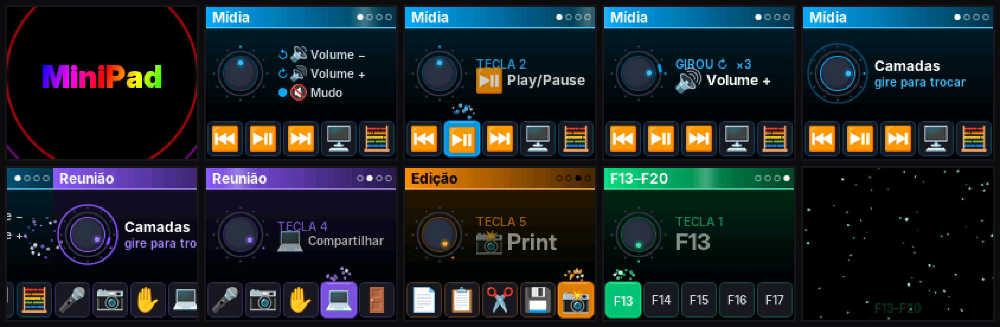
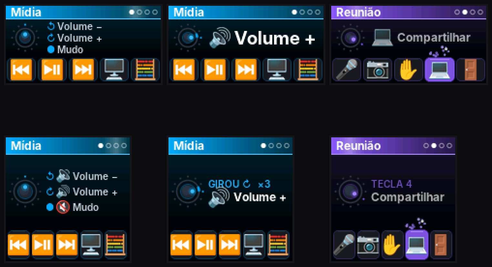

# MiniPad: 5 teclas, encoder e tela colorida

Versão compacta do MacroPad, com **5 teclas**, um **encoder rotativo** EC11 e uma
tela colorida **ST7735S** (SPI de 4 fios). A placa é uma **Waveshare RP2040-Zero**.




## O que tem de diferente

- **Os dois núcleos do RP2040 trabalham ao mesmo tempo.** O núcleo 0 cuida só das
  teclas, do encoder e da USB. O núcleo 1 desenha as animações. Por isso a
  animação nunca atrasa uma tecla.
- **Quadros inteiros na RAM e envio por DMA.** Cada quadro é desenhado na memória
  (40 KB) e enviado por DMA enquanto o próximo já está sendo desenhado (*double
  buffer*). O resultado são ~50 quadros por segundo, sem piscar.
- **Texto suave com acentos** (fonte Inter com *anti-aliasing*) e **ícones
  coloridos** (emojis) nas teclas.
- **Animações:**
  - abertura com o logo em arco-íris;
  - dial do encoder que gira com "rastro" de luz e onda no clique;
  - partículas saindo da tecla apertada;
  - a última ação aparece em destaque, com contador (`×3`) quando repete;
  - a camada inteira desliza para o lado ao trocar;
  - descanso de tela com estrelas depois de 1 minuto;
  - a tela apaga depois de 10 minutos.
- O **LED RGB da própria placa** (GP16) "respira" na cor da camada e pisca a
  cada tecla.

## Peças

| Qtd | Peça | Observação |
|---|---|---|
| 1 | Waveshare RP2040-Zero | ou Raspberry Pi Pico (mesmos GPIOs) |
| 1 | Tela ST7735S SPI | 1.8" 128x160 (padrão), 0.96" 80x160 ou 1.44" 128x128 |
| 5 | Switches mecânicos (MX ou compatíveis) + keycaps | |
| 1 | Encoder EC11 com botão + knob | |
| — | Fios finos | não precisa de diodos nem de resistores |

## Ligações

Todas as teclas e o encoder fecham contato com o **GND**: o firmware liga os
*pull-ups* internos.

| Componente | Pino do componente | RP2040-Zero |
|---|---|---|
| Tecla 1…5 | um lado / outro lado | GP0, GP1, GP2, GP3, GP4 / GND |
| Encoder | A / B / C (meio) | GP5 / GP6 / GND |
| Botão do encoder | SW / outro pino | GP7 / GND |
| Tela | GND / VCC | GND / **3V3** |
| Tela | SCL (SCK) | GP10 |
| Tela | SDA (MOSI) | GP11 |
| Tela | RES | GP12 |
| Tela | DC (A0) | GP8 |
| Tela | CS | GP9 |
| Tela | BLK (BL / LED) | GP13 |

Nos módulos, "SCL" e "SDA" são nomes enganosos: a ligação é **SPI**, não I2C.
Ficam livres GP14, GP15 e GP26 a GP29.

Os nomes dos pinos estão impressos na própria placa (GP0 a GP15 nas laterais e na ponta).

## Como gravar

1. No Arduino IDE, instale o core **Raspberry Pi Pico/RP2040/RP2350** (Earle
   Philhower). Em *Preferências*, adicione esta URL de placas:
   `https://github.com/earlephilhower/arduino-pico/releases/download/global/package_rp2040_index.json`
2. Instale as bibliotecas **Adafruit GFX**, **Adafruit ST7735 and ST7789** e
   **Adafruit NeoPixel**.
3. Placa: **Waveshare RP2040 Zero**. Em *Ferramentas > USB Stack*, deixe **Pico SDK**.
4. Grave primeiro **`firmware/Teste_Hardware`**, que testa a tela, as teclas, o
   encoder e o LED. Confira as faixas de cor do topo: devem aparecer **vermelho,
   verde, azul e branco**, nessa ordem.
5. Depois grave **`firmware/MiniPad`**.

Se a placa não aparecer para gravar, segure o botão **BOOT**, aperte **RESET** e
solte os dois. A placa vira um pendrive e o IDE grava nela.

## Ajustes da tela (`config.h`)

| Sintoma | Ajuste |
|---|---|
| Tela de outro tamanho | `LCD_MODEL` → `LCD_180`, `LCD_096` ou `LCD_144` |
| Borda com "lixo" ou imagem deslocada | troque `LCD_INIT` (ex.: `INITR_GREENTAB`) |
| Vermelho e azul trocados | `LCD_BGR 1` |
| Cores em negativo | `LCD_INVERT 1` (ou 0, se já estiver em 1) |
| Imagem de cabeça para baixo | `LCD_ROTATION 3` |
| Imagem com falhas ou riscos | `LCD_SPI_HZ 16000000` (fios longos) |
| LED da placa com cor trocada | `BOARD_LED_ORDER NEO_GRB` |

Outras telas, também suportadas:



## Usando

- **Teclas:** fazem a ação da camada atual. Atalhos ficam pressionados enquanto a
  tecla estiver apertada.
- **Girar o encoder:** ação de girar (por padrão, o volume).
- **Clicar o encoder:** ação de clique (por padrão, mudo).
- **Segurar o botão do encoder e girar:** troca de camada.

As camadas vêm prontas: **Mídia**, **Reunião** (atalhos do Teams), **Edição** e
**F13–F20**. Para mudar, edite a lista `LAYERS` no `config.h`:

```cpp
KEYS("💾 Salvar", KEY_LEFT_CTRL, 's'),     // atalho
MEDIA("⏯ Play/Pause", KEY_PLAY_PAUSE),     // tecla de mídia
TEXT("✏ Obrigado", "Obrigado!"),        // digita um texto (sem acentos)
```

Se o nome começar com um emoji da lista em `ferramentas/gerar_icones.py`, a tecla
mostra o ícone. Sem emoji, mostra o nome, que deve ser curto (ex.: "F13").
Para usar outros emojis, acrescente na lista e rode o script (precisa de
`pip install pillow` e da fonte Noto Color Emoji).

## Ferramentas (`ferramentas/`)

- `gerar_fontes.py`: gera o `fonts.h` (fonte Inter, com acentos).
- `gerar_icones.py`: gera o `icons.h` (Noto Color Emoji).
- `simulador/`: roda a **mesma interface do firmware no PC** e gera as imagens
  desta página (`python3 simulador/gerar_previa.py`, precisa de g++ e pillow).
  Dá para testar mudanças na tela sem gravar a placa.

## Licenças das fontes

Inter (Rasmus Andersson) e Noto Color Emoji (Google): ambas são SIL Open Font
License 1.1.
