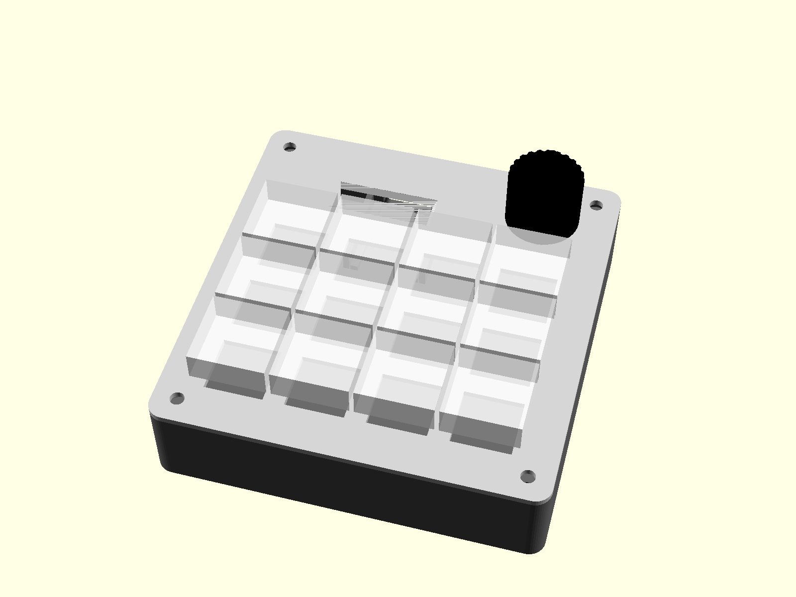

# MacroPad 4x3 + encoder (RP2350, Arduino IDE)

Macropad USB com **12 teclas mecânicas**, **encoder rotativo com clique**, **tela OLED**
e **LEDs RGB** (opcionais). O PC reconhece como um teclado comum, sem driver nem
programa extra, no Windows, Linux e macOS.



```
 ┌──────────────────────────────────┐
 │   [ OLED  Geral / Volume + ]  (◎)│  ← encoder
 │  ┌────┐ ┌────┐ ┌────┐ ┌────┐     │
 │  │ K1 │ │ K2 │ │ K3 │ │ K4 │     │
 │  └────┘ └────┘ └────┘ └────┘     │
 │  ┌────┐ ┌────┐ ┌────┐ ┌────┐     │
 │  │ K5 │ │ K6 │ │ K7 │ │ K8 │     │
 │  └────┘ └────┘ └────┘ └────┘     │
 │  ┌────┐ ┌────┐ ┌────┐ ┌────┐     │
 │  │ K9 │ │K10 │ │K11 │ │K12 │     │
 │  └────┘ └────┘ └────┘ └────┘     │
 └──────────────────────────────────┘
```

## Estrutura

| Pasta | Conteúdo |
|---|---|
| `firmware/MacroPad/` | Sketch do Arduino (`MacroPad.ino`). **Toda a personalização fica em `config.h`.** |
| `case/macropad_case.scad` | Caixa paramétrica em OpenSCAD |
| `case/stl/` | STLs prontos (versão para RP2350-Zero + OLED 0.91") |

---

## 1. Lista de materiais

| Qtd | Item | Observação |
|---|---|---|
| 1 | **Waveshare RP2350-Zero** *(ou Raspberry Pi Pico 2)* | USB nativo, o PC vê como teclado |
| 12 | Switches mecânicos MX (Gateron, Kailh, Outemu…) | Qualquer switch padrão MX |
| 12 | Keycaps MX 1u | Perfil baixo (DSA/XDA) fica bonito em macropad |
| 1 | Encoder **EC11** com botão (eixo D de 6 mm, rosca M7) | Com 20 ou 24 cliques por volta |
| 1 | OLED **SSD1306 I2C 0.91" 128x32** | Também serve o 0.96" 128x64 (veja abaixo) |
| 12 | LEDs **WS2812B** *(opcional)* | Pedaço de fita 5 V ou módulos avulsos |
| 1 | Resistor 330 Ω *(se usar LEDs)* | Em série no fio de dados |
| 4 | Parafusos M3 x 8 mm cabeça panela | Rosqueiam direto no plástico |
| 4 | Pezinhos de borracha 8 mm | Opcional |
| — | Fio fino (AWG 26–28 ou fio de cabo de rede) | Para a ligação |

> Por que não o ESP32 comum? Ele **não tem USB nativo** e não aparece como
> teclado no PC (só por Bluetooth). A RP2350 faz isso direto e funciona muito bem
> com o Arduino IDE.

---

## 2. Ligação (sem matriz e sem diodos)

Cada tecla tem um pino próprio. Isso é mais simples de soldar e nunca dá
"ghosting". Os pinos escolhidos ficam nas **bordas da RP2350-Zero** e também
existem na **Pico 2**, então a mesma ligação serve para as duas.

| Componente | Pino do componente | Liga em |
|---|---|---|
| K1 … K12 | perna 1 | **GP0 … GP11** (K1=GP0, K2=GP1 … K12=GP11) |
| K1 … K12 | perna 2 | **GND** (todas juntas, um fio passando por todas) |
| Encoder | A | **GP14** |
| Encoder | B | **GP15** |
| Encoder | C (pino do meio, lado de 3 pinos) | **GND** |
| Encoder | SW (lado de 2 pinos) | **GP26** e o outro pino no **GND** |
| OLED | VCC / GND | **3V3** / **GND** |
| OLED | SDA / SCL | **GP12** / **GP13** |
| LEDs WS2812B | 5V / GND | **5V** / **GND** |
| LEDs WS2812B | DIN | **GP27**, passando pelo resistor de 330 Ω |

```
      RP2350-Zero (vista de cima, USB para cima)
                ___(USB-C)___
          5V  1|             |23 GP0  ── K1
         GND  2|             |22 GP1  ── K2
         3V3  3|             |21 GP2  ── K3
        GP29  4|             |20 GP3  ── K4
        GP28  5|             |19 GP4  ── K5
LEDs ── GP27  6|             |18 GP5  ── K6
Enc SW─ GP26  7|             |17 GP6  ── K7
Enc B ─ GP15  8|             |16 GP7  ── K8
Enc A ─ GP14  9|             |15 GP8  ── K9
               |_____________|
               GP13 GP12 GP11 GP10 GP9
                SCL  SDA  K12  K11 K10
```

Não precisa de resistor nas teclas nem no encoder: o firmware liga os
pull-ups internos.

---

## 3. Arduino IDE

1. **Arquivo → Preferências → URLs adicionais para gerenciadores de placas**, cole:
   ```
   https://github.com/earlephilhower/arduino-pico/releases/download/global/package_rp2040_index.json
   ```
2. **Ferramentas → Placa → Gerenciador de Placas**: instale
   **"Raspberry Pi Pico/RP2040/RP2350"** (de Earle F. Philhower). Testado com a versão 6.3.2.
3. **Gerenciador de Bibliotecas**: instale
   - `Adafruit NeoPixel`
   - `Adafruit SSD1306` (ele pede também a `Adafruit GFX Library` e a `Adafruit BusIO`: aceite)
4. Abra `firmware/MacroPad/MacroPad.ino`.
5. **Ferramentas → Placa**: `Waveshare RP2350 Zero` (ou `Raspberry Pi Pico 2`).
   **Ferramentas → USB Stack**: deixe em `Pico SDK` (o padrão).
6. **Primeira gravação**: segure o botão **BOOT** da placa, conecte o USB e solte.
   A placa aparece como um pendrive. Clique em **Carregar**. Nas próximas vezes o
   Arduino IDE grava direto.

Se você não for usar a tela ou os LEDs, mude `USE_OLED` ou `USE_LEDS` para `0`
no `config.h`.

---

## 4. Como usar

| Ação | O que faz |
|---|---|
| Apertar uma tecla | Executa a ação da camada atual (a tela mostra o nome) |
| Girar o encoder | Ação de girar da camada (padrão: **volume**) |
| Clicar no encoder | Ação de clique da camada (padrão: **mudo**) |
| **Segurar o encoder e girar** | **Troca de camada** (a cor dos LEDs muda) |

### Camadas que já vêm configuradas

**1. Geral** (azul). Encoder: volume, e o clique deixa mudo.

| Copiar | Colar | Desfazer | Refazer |
|---|---|---|---|
| ⏮ Anterior | ⏯ Play/Pause | ⏭ Próxima | Calculadora |
| Print (Win+Shift+S) | Mostrar desktop | Gerenciador de Tarefas | Bloquear PC |

**2. Navegador** (laranja). Encoder: troca de aba, e o clique abre uma aba nova.

| Nova aba | Fechar aba | Reabrir aba | Recarregar |
|---|---|---|---|
| Voltar | Avançar | Zoom + | Zoom − |
| Janela anônima | Favoritar | Tela cheia | Zoom 100% |

**3. F13–F24** (roxo). Encoder: setas ←/→, e o clique dá Enter.
São teclas que nenhum teclado normal tem, ótimas para atalhos globais no
**OBS, Discord, Photoshop, DaVinci, AutoHotkey** etc. Elas não conflitam com nada.

---

## 5. Personalizar (`config.h`)

Cada tecla é uma linha:

```cpp
KEYS("Copiar",   KEY_LEFT_CTRL, 'c'),           // atalho (até 4 teclas)
MEDIA("Mudo",    KEY_MUTE),                     // tecla de mídia
TEXT("Email",    "meu.email@exemplo.com"),      // digita um texto
LAYER_NEXT,                                     // próxima camada
NONE,                                           // nada
```

- **Teclas especiais:** `KEY_LEFT_CTRL`, `KEY_LEFT_SHIFT`, `KEY_LEFT_ALT`,
  `KEY_LEFT_GUI` (tecla Windows), `KEY_F1`…`KEY_F24`, `KEY_RETURN`, `KEY_ESC`,
  `KEY_TAB`, setas `KEY_UP_ARROW` etc.
- **Mídia:** `KEY_PLAY_PAUSE`, `KEY_SCAN_NEXT`, `KEY_SCAN_PREVIOUS`, `KEY_MUTE`,
  `KEY_VOLUME_INCREMENT`, `KEY_VOLUME_DECREMENT`, `KEY_AL_CALCULATOR`,
  `KEY_BRIGHTNESS_INCREMENT`…
- **Mais camadas:** aumente `NUM_LAYERS` e copie um bloco `{ ... }`.
- **Cor de cada camada:** os três números depois do nome (R, G, B).
- **Encoder com o sentido trocado** ou contando 2 passos por clique: ajuste
  `ENC_REVERSE` e `ENC_STEPS_PER_DETENT`.

> ⚠️ **Teclado ABNT2:** o firmware envia teclas como um teclado americano.
> Atalhos com letras, números, F-keys e mídia funcionam normalmente. Mas
> `TEXT(...)` com símbolos (`@ / ? ; ç ~`) pode sair trocado se o Windows estiver
> em ABNT2. Use só letras e números no `TEXT`, ou configure o Windows em
> "Inglês (EUA) – Internacional".

---

## 6. Caixa impressa em 3D

Arquivos em `case/`. Os STLs prontos estão em `case/stl/`:

| Peça | Como imprimir |
|---|---|
| `macropad_bottom.stl` | Fundo na mesa, sem suporte. 3 paredes e 15–20% de preenchimento |
| `macropad_plate.stl` | Já está virado (topo na mesa), sem suporte. **Imprima com 100% de preenchimento** para os clipes dos switches ficarem firmes |
| `macropad_knob.stl` | Em pé, sem suporte |

Tamanho: **92 x 95 x 22 mm**. Camada de 0.2 mm em PLA ou PETG funciona bem.

**Mudar as opções** (abra o `.scad` no OpenSCAD e use o *Customizer*, ou edite no topo):

- `board = "pico2"` para a Raspberry Pi Pico 2 (furo micro-USB e berço maior)
- `oled = "096"` para o OLED 0.96" 128x64 (e no `config.h` coloque `OLED_HEIGHT 64`)
- `sw_cut = 14.1` se os switches entrarem muito justos
- `post_hole = 4.2` para usar insertos térmicos M3

### Montagem
1. Encaixe os 12 switches no plate (de cima para baixo, até estalar).
2. Prenda o encoder com a porca que vem com ele.
3. Cole o OLED na moldura embaixo do plate (cola quente nas bordas ou fita dupla face).
4. Encaixe a placa no berço da caixa, com o USB virado para o furo de trás.
5. Solde os fios conforme a tabela da seção 2.
6. **Grave e teste antes de fechar.**
7. Feche com os 4 parafusos M3 e coloque o knob e as keycaps.

**LEDs:** numa montagem com fios soltos, o mais fácil é colar uma fita WS2812B
no fundo da caixa como *underglow* (`LED_PER_KEY 0`, e ajuste `LED_COUNT`). Para ter
um LED embaixo de cada tecla (`LED_PER_KEY 1`), o ideal é uma PCB própria, que
pode ser a versão 2 do projeto.
