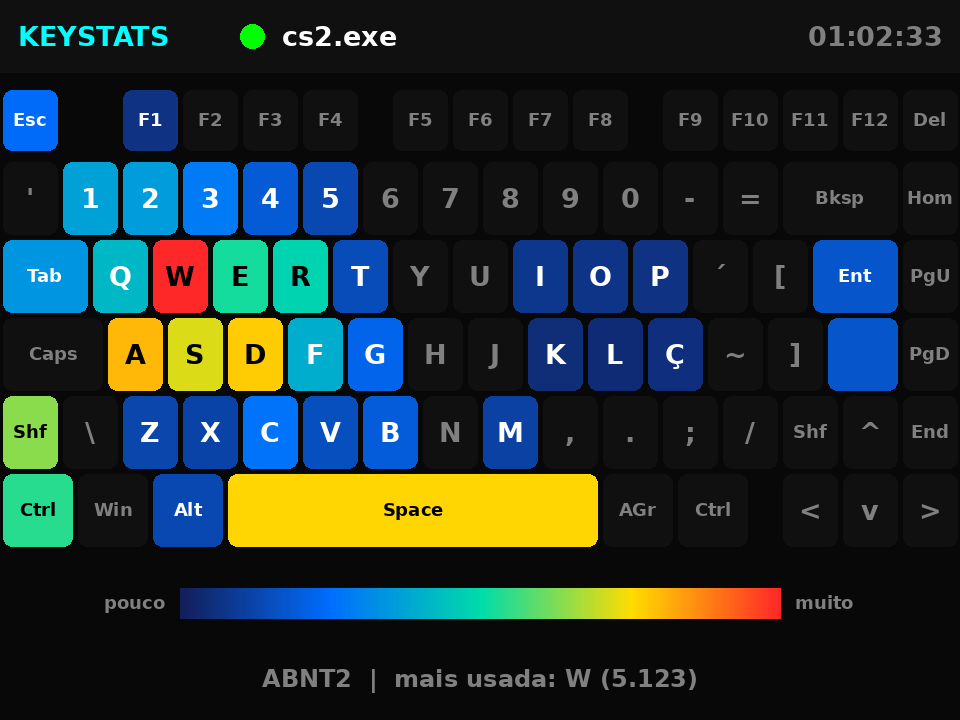

# KeyStats Panel (MVP)

Painel de estatísticas de teclado para gamers: um **ESP32 Cheap Yellow Display** ao lado
do teclado mostra, em tempo real, quantas teclas por minuto você está apertando, o seu pico,
os totais e as teclas mais usadas.

```
 PC (agente Python)  ──USB serial, JSON 5x/s──▶  ESP32-2432S028R (CYD)
  captura teclas,                                 desenha as telas no LCD 2,8"
  conta e agrega                                  touch / BOOT troca de tela
```

## Telas

| Tela | Conteúdo |
|---|---|
| **Ao vivo** | KPM atual (a cor muda conforme a intensidade), pico de KPM, teclas da sessão, total histórico e gráfico dos últimos 60 s |
| **Top teclas** | As 8 teclas mais usadas, com barras proporcionais |
| **Mapa de calor** | O teclado inteiro (formato 75%, ABNT2 ou ANSI) colorido do azul ao vermelho conforme o uso de cada tecla |



*Prévia gerada por simulação, com a mesma geometria e as mesmas cores do firmware. No display real, as fontes são as bitmap do LovyanGFX.*

O cabeçalho mostra o status da conexão, o aplicativo/jogo em foco e o tempo de sessão.
Para trocar de tela, **toque no display** ou aperte o botão **BOOT**.

O LED RGB da placa indica o estado: **azul** = aguardando, **verde** = recebendo dados, **vermelho** = conexão perdida.

## Estrutura

```
projects/keystats-panel/
├── firmware/keystats_cyd/
│   ├── keystats_cyd.ino   # firmware do painel
│   ├── lgfx_cyd.h         # configuração do display/touch do CYD
│   └── keyboard_layout.h  # layouts ABNT2/ANSI do mapa de calor
├── agent/
│   ├── keystats_agent.py       # agente que roda no PC
│   ├── test_keystats_agent.py  # testes (python -m unittest)
│   └── requirements.txt
└── docs/preview_heatmap.png
```

## 1. Gravar o firmware

1. Instale o suporte ao ESP32 na Arduino IDE: em *Preferências → URLs adicionais*, adicione
   `https://espressif.github.io/arduino-esp32/package_esp32_index.json` e instale **esp32 by Espressif** (3.x) no Gerenciador de Placas.
2. Instale as bibliotecas pelo Gerenciador de Bibliotecas:
   - **LovyanGFX** (testado com 1.2.0)
   - **ArduinoJson** (testado com 7.2.1)
3. Abra `firmware/keystats_cyd/keystats_cyd.ino`.
4. Selecione a placa **ESP32 Dev Module** e a porta correta, e clique em *Carregar*.

> No Windows, se a porta não aparecer, instale o driver **CH340** (é o chip USB-serial mais comum no CYD).

### Variantes do CYD

Em `lgfx_cyd.h`:
- Placa com **duas portas USB** (micro-USB + USB-C): descomente `#define CYD_PANEL_ST7789`.
- Cores invertidas (fundo branco, cores "negativas"): descomente `#define CYD_INVERT_COLORS`.

### Layout do teclado (mapa de calor)

O padrão é **ABNT2** (com Ç). Para teclado americano:
1. Em `keyboard_layout.h`, descomente `#define KEYSTATS_LAYOUT_ANSI`.
2. Rode o agente com `--layout ansi`.

Firmware e agente precisam usar o **mesmo** layout, porque o agente converte cada caractere para a tecla física (ex.: `!` conta como `1`, `?` como `/`, `^` como `~` no ABNT2).

Ao ligar, deve aparecer a tela "KeyStats Panel — Conecte o USB e rode o agente no PC".

## 2. Rodar o agente no PC

```bash
cd projects/keystats-panel/agent
pip install -r requirements.txt
python keystats_agent.py
```

O agente encontra a porta do painel automaticamente (CH340, CP210x, FTDI e USB nativo da Espressif).
Opções úteis:

| Opção | Para quê |
|---|---|
| `--port COM5` / `--port /dev/ttyUSB0` | escolher a porta manualmente |
| `--demo` | gerar digitação simulada (ótimo para testar o painel) |
| `--stdout` | imprimir o JSON no terminal em vez de enviar |
| `--no-app` | não detectar o aplicativo em foco |
| `--layout ansi` | teclado americano (padrão: `abnt2`) |

**Importante:** feche o *Monitor Serial* da Arduino IDE antes de rodar o agente, porque só um programa pode usar a porta por vez.

### Observações por sistema

- **Windows:** funciona direto. O nome do jogo vem do processo em foco (ex.: `cs2.exe`).
- **macOS:** dê permissão em *Ajustes do Sistema → Privacidade e Segurança → Monitoramento de Entrada* (e *Acessibilidade*) para o Terminal/Python.
- **Linux:** a captura global funciona em sessões **X11**. No Wayland, o pynput não recebe as teclas de outros aplicativos. Para detectar o app em foco, instale o `xdotool`. Para acessar a serial, adicione seu usuário ao grupo `dialout`.

## Privacidade

O agente guarda **apenas contagens por tecla** em `~/.keystats/state.json`.
A ordem do que foi digitado nunca é registrada nem enviada; senhas e mensagens não podem ser reconstruídas a partir desses dados.
No modo `--demo`, os dados ficam em um arquivo separado (`demo_state.json`) para não misturar com o histórico real.

> O agente usa um hook de teclado somente-leitura do sistema operacional. Ele não injeta teclas nem lê a memória de jogos, mas, se você joga títulos com anti-cheat muito restritivo, teste antes em partidas casuais.

## Como as métricas são calculadas

- **KPM:** teclas pressionadas nos últimos 10 s × 6. A janela curta deixa o medidor mais responsivo.
- **Pico:** o maior KPM registrado na sessão atual do agente.
- **Sessão / Tempo:** contados desde que o agente foi iniciado.
- **Total / Top teclas:** histórico acumulado, salvo em disco a cada 30 s e ao sair.
- Teclas seguradas contam **uma vez**, porque o auto-repeat do sistema é ignorado.
- **Mapa de calor:** usa o histórico total. A intensidade é `255 × √(contagem / máximo)`; com a raiz quadrada, teclas pouco usadas continuam visíveis ao lado do W/A/S/D.

## Protocolo serial

115200 baud, uma linha JSON por mensagem, terminada em `\n`, enviada 5 vezes por segundo:

```json
{"kpm":312,"peak":540,"sess":1834,"total":184233,"up":3605,"app":"cs2.exe",
 "top":[["W",5123],["A",3301],["SPACE",2980]]}
```

| Campo | Significado |
|---|---|
| `kpm` | teclas por minuto agora |
| `peak` | pico de KPM na sessão |
| `sess` | teclas na sessão |
| `total` | teclas no histórico |
| `up` | segundos de sessão |
| `app` | processo em foco (até 39 caracteres) |
| `top` | até 8 pares `[tecla, contagem]`, em ordem decrescente |

A cada 2 s, o agente envia também uma linha com o mapa de calor, com intensidades de 1 a 255 por tecla:

```json
{"heat":{"W":255,"A":204,"SPACE":195,"CCED":14},"hmax":5123}
```

Nomes de tecla: letras e dígitos (`A`, `7`), pontuação pela tecla física sem Shift (`-`, `;`, `/`…),
especiais (`SPACE`, `ENTER`, `BKSP`, `SHIFT`, `RSHIFT`, `CTRL`, `ALTGR`, `F1`…) e, no ABNT2, `CCED` (Ç) e `ACUTE` (´).
A lista completa está em `keyboard_layout.h`; o teste `test_agent_names_exist_in_firmware_layout` garante que o agente e o firmware usam os mesmos nomes.

Se o painel ficar 3 s sem receber dados, ele mostra a conexão como perdida.

## Testes

```bash
cd projects/keystats-panel/agent
python -m unittest test_keystats_agent.py
```

## Próximos passos

- ~~Tela de **mapa de calor** do teclado (layout ABNT2/ANSI)~~ ✅ v2
- Alternar o mapa de calor entre **sessão** e **histórico** com um toque longo
- Interface com **LVGL** e animações
- Estatísticas **por jogo**
- Conexão por **Wi-Fi** (WebSocket), sem cabo
- Histórico no cartão SD e resumo diário/semanal
- Case impresso em 3D
